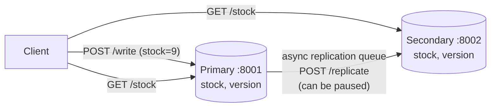
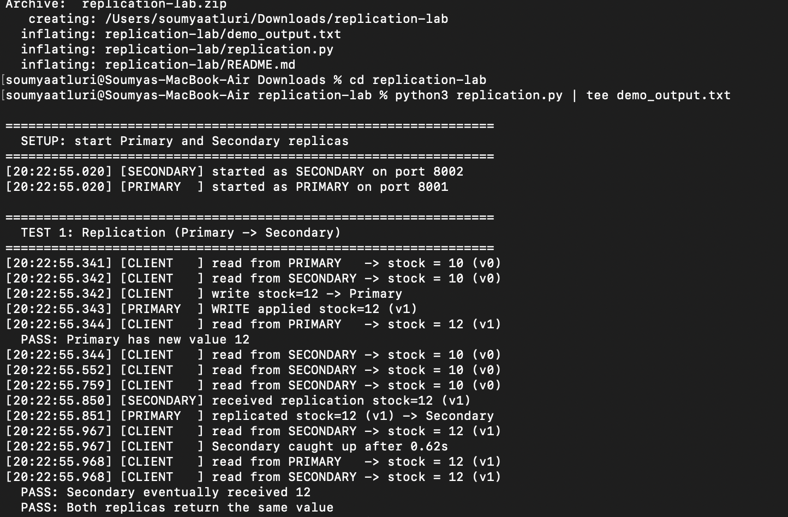
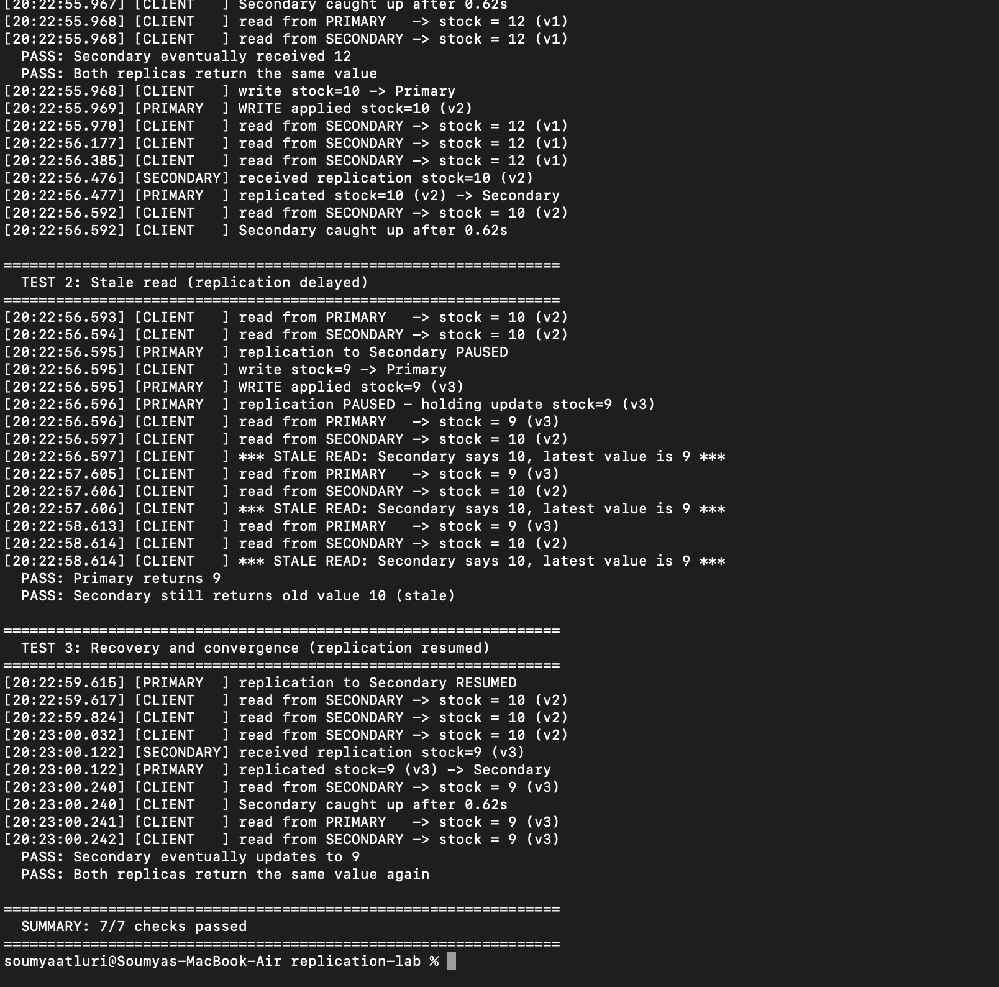
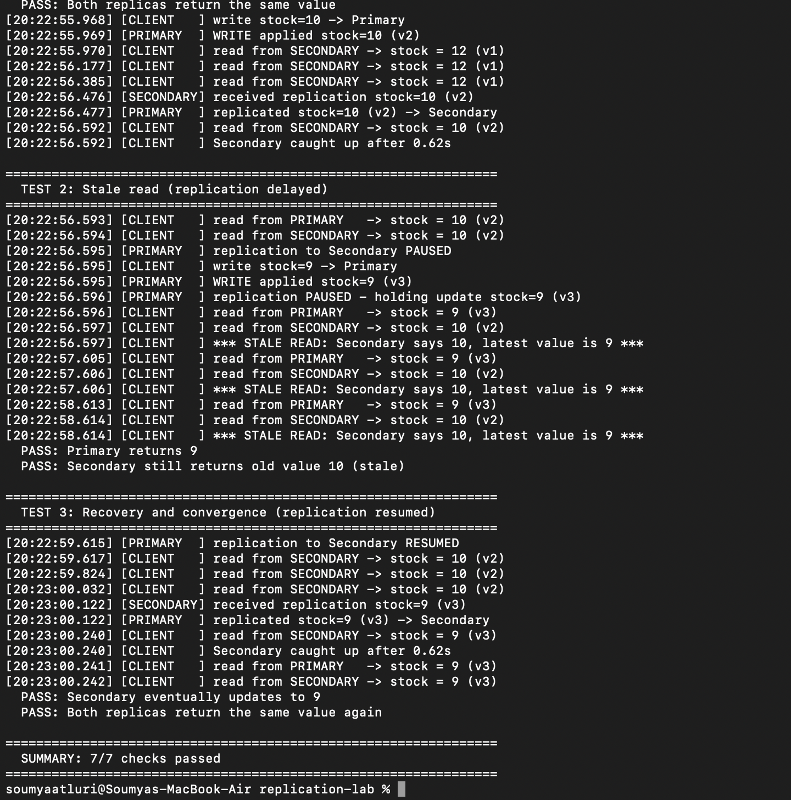

# Module 8: Replication & Consistency Lab

A small replicated inventory system in **Python** (standard library only) that shows
asynchronous primary-backup replication, a **stale read** on a lagging replica, and
**convergence** once replication resumes.

- **Primary replica**: HTTP server on port `8001`. It accepts all writes.
- **Secondary replica**: HTTP server on port `8002`. It's a read-only copy that gets updates from the Primary.
- **Client**: reads `stock` from either replica and sends writes to the Primary.

Starting inventory: `stock = 10`

---

## How to run

**Requirements:** Python 3.8 or newer. No packages to install.

```bash
git clone <your-repo-url>
cd <your-repo-folder>
python3 replication.py        # on Windows: python replication.py
```

The script starts both replicas and runs all three tests automatically. It prints
timestamped logs and finishes with a `PASS`/`FAIL` summary. To save the output to a file:

```bash
python3 replication.py | tee demo_output.txt
```

---

## Architecture



Plain-text version:

```
                 write (POST /write)
   +--------+  ------------------------->  +-------------------+
   |        |                              |  PRIMARY  :8001   |
   | CLIENT |  <---- read (GET /stock) --> |  stock, version   |
   |        |                              +---------+---------+
   |        |                                        | async replication
   |        |                                        | (queue + background thread,
   |        |                                        |  0.5s simulated latency,
   |        |                                        |  can be PAUSED/RESUMED)
   |        |                                        v  POST /replicate
   |        |                              +-------------------+
   |        |  <---- read (GET /stock) --> |  SECONDARY :8002  |
   +--------+                              |  stock, version   |
                                           +-------------------+
```

**How it works**

1. The client sends a write to the Primary. The Primary applies it right away, gives it a
   new **version number**, and adds it to a replication queue.
2. A background thread on the Primary sends each queued update to the Secondary
   (`POST /replicate`) after a simulated network delay of 0.5s.
3. To simulate a lagging replica, `POST /pause-replication` makes the thread hold updates.
   `POST /resume-replication` releases them.
4. The Secondary only applies an update whose version is newer than its own, so duplicate
   or out-of-order messages can't roll it back.

| Endpoint | Replica | Purpose |
|---|---|---|
| `GET /stock` | both | Read current stock and version |
| `POST /write` | Primary only | Client write (Secondary rejects it with 403) |
| `POST /replicate` | Secondary | Receives replicated updates |
| `POST /pause-replication` | Primary | Simulate replication delay |
| `POST /resume-replication` | Primary | Resume replication |

---

## Results / Evidence

The output below comes from running `python3 replication.py` (full log in
[`demo_output.txt`](demo_output.txt)). Screenshots are in [`screenshots/`](screenshots/).

### 1. Replication

The client writes `stock = 12` to the Primary. The Primary updates right away. The
Secondary still shows `10` for about 0.6s, then receives the update. After that, both
return `12`. (The script then resets stock to `10` to set up Test 2.)

```
================================================================
  TEST 1: Replication (Primary -> Secondary)
================================================================
[20:25:28.248] [CLIENT   ] read from PRIMARY   -> stock = 10 (v0)
[20:25:28.249] [CLIENT   ] read from SECONDARY -> stock = 10 (v0)
[20:25:28.249] [CLIENT   ] write stock=12 -> Primary
[20:25:28.249] [PRIMARY  ] WRITE applied stock=12 (v1)
[20:25:28.250] [CLIENT   ] read from PRIMARY   -> stock = 12 (v1)
  PASS: Primary has new value 12
[20:25:28.251] [CLIENT   ] read from SECONDARY -> stock = 10 (v0)
[20:25:28.458] [CLIENT   ] read from SECONDARY -> stock = 10 (v0)
[20:25:28.666] [CLIENT   ] read from SECONDARY -> stock = 10 (v0)
[20:25:28.752] [SECONDARY] received replication stock=12 (v1)
[20:25:28.753] [PRIMARY  ] replicated stock=12 (v1) -> Secondary
[20:25:28.873] [CLIENT   ] read from SECONDARY -> stock = 12 (v1)
[20:25:28.873] [CLIENT   ] Secondary caught up after 0.62s
[20:25:28.874] [CLIENT   ] read from PRIMARY   -> stock = 12 (v1)
[20:25:28.875] [CLIENT   ] read from SECONDARY -> stock = 12 (v1)
  PASS: Secondary eventually received 12
  PASS: Both replicas return the same value
[20:25:28.875] [CLIENT   ] write stock=10 -> Primary
[20:25:28.875] [PRIMARY  ] WRITE applied stock=10 (v2)
[20:25:28.876] [CLIENT   ] read from SECONDARY -> stock = 12 (v1)
[20:25:29.084] [CLIENT   ] read from SECONDARY -> stock = 12 (v1)
[20:25:29.291] [CLIENT   ] read from SECONDARY -> stock = 12 (v1)
[20:25:29.383] [SECONDARY] received replication stock=10 (v2)
[20:25:29.383] [PRIMARY  ] replicated stock=10 (v2) -> Secondary
[20:25:29.494] [CLIENT   ] read from SECONDARY -> stock = 10 (v2)
[20:25:29.494] [CLIENT   ] Secondary caught up after 0.62s
```

### 2. Stale-read test

Replication is **paused** and the client writes `stock = 9` to the Primary. For several
seconds the Primary returns `9` while the Secondary keeps returning the old value `10`.
That's a **stale read**: a client reading from the Secondary sees data that's out of date.

```
================================================================
  TEST 2: Stale read (replication delayed)
================================================================
[20:25:29.496] [CLIENT   ] read from PRIMARY   -> stock = 10 (v2)
[20:25:29.496] [CLIENT   ] read from SECONDARY -> stock = 10 (v2)
[20:25:29.497] [PRIMARY  ] replication to Secondary PAUSED
[20:25:29.497] [CLIENT   ] write stock=9 -> Primary
[20:25:29.498] [PRIMARY  ] WRITE applied stock=9 (v3)
[20:25:29.498] [PRIMARY  ] replication PAUSED - holding update stock=9 (v3)
[20:25:29.499] [CLIENT   ] read from PRIMARY   -> stock = 9 (v3)
[20:25:29.499] [CLIENT   ] read from SECONDARY -> stock = 10 (v2)
[20:25:29.499] [CLIENT   ] *** STALE READ: Secondary says 10, latest value is 9 ***
[20:25:30.507] [CLIENT   ] read from PRIMARY   -> stock = 9 (v3)
[20:25:30.507] [CLIENT   ] read from SECONDARY -> stock = 10 (v2)
[20:25:30.508] [CLIENT   ] *** STALE READ: Secondary says 10, latest value is 9 ***
[20:25:31.512] [CLIENT   ] read from PRIMARY   -> stock = 9 (v3)
[20:25:31.513] [CLIENT   ] read from SECONDARY -> stock = 10 (v2)
[20:25:31.514] [CLIENT   ] *** STALE READ: Secondary says 10, latest value is 9 ***
  PASS: Primary returns 9
  PASS: Secondary still returns old value 10 (stale)
```

### 3. Recovery and convergence

Replication is **resumed**. The held update (`stock = 9`, v3) is delivered and the
Secondary catches up. Both replicas return `9` again, so the system has **converged**.

```
================================================================
  TEST 3: Recovery and convergence (replication resumed)
================================================================
[20:25:32.516] [PRIMARY  ] replication to Secondary RESUMED
[20:25:32.518] [CLIENT   ] read from SECONDARY -> stock = 10 (v2)
[20:25:32.725] [CLIENT   ] read from SECONDARY -> stock = 10 (v2)
[20:25:32.933] [CLIENT   ] read from SECONDARY -> stock = 10 (v2)
[20:25:33.019] [SECONDARY] received replication stock=9 (v3)
[20:25:33.019] [PRIMARY  ] replicated stock=9 (v3) -> Secondary
[20:25:33.140] [CLIENT   ] read from SECONDARY -> stock = 9 (v3)
[20:25:33.140] [CLIENT   ] Secondary caught up after 0.62s
[20:25:33.141] [CLIENT   ] read from PRIMARY   -> stock = 9 (v3)
[20:25:33.142] [CLIENT   ] read from SECONDARY -> stock = 9 (v3)
  PASS: Secondary eventually updates to 9
  PASS: Both replicas return the same value again

================================================================
  SUMMARY: 7/7 checks passed
================================================================
```

### Screenshots





---

## Reflection

**What tradeoff exists between reading quickly from a replica and guaranteeing that the
reader sees the latest value?**

Reading from a nearby Secondary is fast and takes load off the Primary. With asynchronous
replication, though, the Secondary can lag behind, so the reader may get a stale value, as
Test 2 showed (`10` instead of `9`). To make sure a reader always sees the latest value, the
system has to read from the Primary, or wait until the write is confirmed on every replica
(synchronous replication or quorum reads). Both options add latency and make the system less
available when a replica is slow or down. So the tradeoff is **latency and availability
versus consistency**: eventual consistency gives fast reads that may be stale for a while,
and strong consistency gives up speed so that every read is correct.

---

## Files

| File | Description |
|---|---|
| `replication.py` | Primary, Secondary, client, and the three-test demo |
| `demo_output.txt` | Captured terminal output from a full run |
| `screenshots/` | Terminal screenshots of each test |
